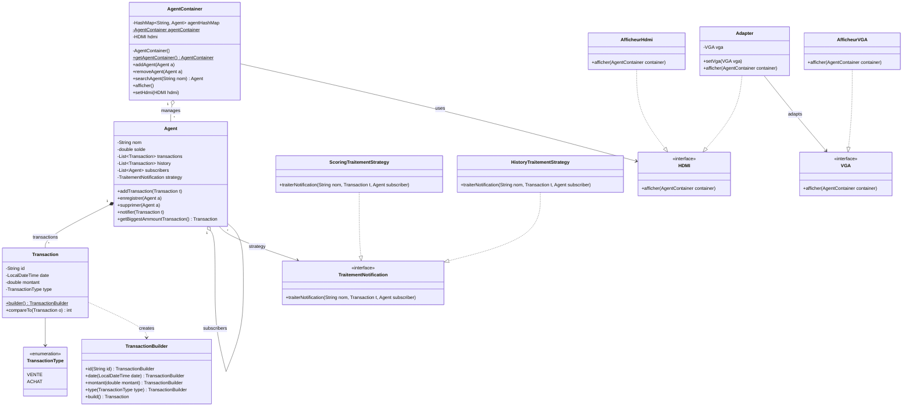

# Examen Blanc - Design Patterns & Programmation Orientée Aspect (AOP)

Ce projet implémente une application de gestion de conteneurs d'agents et de transactions financières en mettant en œuvre plusieurs **Design Patterns (GoF)** ainsi que la **Programmation Orientée Aspect (AOP)** avec **AspectJ**.

---

## 📋 Table des Matières
- [Architecture & Technologies](#-architecture--technologies)
- [Structure du Projet](#-structure-du-projet)
- [Design Patterns Implémentés](#-design-patterns-implémentés)
  - [1. Pattern Builder](#1-pattern-builder)
  - [2. Pattern Observer](#2-pattern-observer)
  - [3. Pattern Strategy](#3-pattern-strategy)
  - [4. Pattern Singleton](#4-pattern-singleton)
  - [5. Pattern Adapter](#5-pattern-adapter)
- [Programmation Orientée Aspect (AOP)](#-programmation-orientée-aspect-aop)
  - [1. Journalisation (`@Log`)](#1-journalisation-log)
  - [2. Mise en Cache (`@Cachable`)](#2-mise-en-cache-cachable)
  - [3. Sécurité (`@SecuredBy`)](#3-sécurité-securedby)
- [Diagramme de Classes](#-diagramme-de-classes)
- [Compilation et Exécution](#-compilation-et-exécution)

---

## 🛠 Architecture & Technologies

- **Langage :** Java 21
- **Gestionnaire de build :** Maven
- **AOP :** AspectJ (`aspectjrt` & `aspectjtools` `1.9.27`, `aspectj-maven-plugin` `1.14`)

---

## 📁 Structure du Projet

```text
examen-blanc-design-pattern/
├── pom.xml
└── src/main/java/com/enset/
    ├── Main.java                              # Point d'entrée de l'application
    ├── AgentContainer.java                    # Conteneur Singleton des agents
    ├── adapter/                               # Pattern Adapter (HDMI / VGA)
    │   ├── HDMI.java
    │   ├── AfficheurHdmi.java
    │   ├── VGA.java
    │   ├── AfficheurVGA.java
    │   └── Adapter.java
    ├── annotations/                           # Annotations personnalisées pour l'AOP
    │   ├── Log.java
    │   ├── Cachable.java
    │   └── SecuredBy.java
    ├── aspects/                               # Aspects AspectJ
    │   ├── LogAspect.java
    │   ├── CachableAspect.java
    │   └── SecurityAspect.java
    ├── builder/                               # Pattern Builder pour Transaction
    │   └── TransactionBuilder.java
    ├── models/                                # Modèles métier
    │   ├── Agent.java
    │   ├── Transaction.java
    │   └── enums/
    │       └── TransactionType.java
    ├── security/                              # Contexte d'authentification et rôles
    │   └── SecurityContext.java
    └── strategy/                              # Pattern Strategy pour le traitement des notifications
        ├── TraitementNotification.java
        ├── ScoringTraitementStrategy.java
        └── HistoryTraitementStrategy.java
```

---

## 🧩 Design Patterns Implémentés

### 1. Pattern Builder
Permet de construire des objets complexes `Transaction` étape par étape de manière fluide.
- **Classes :** `Transaction`, `TransactionBuilder`, `TransactionType` (`VENTE`, `ACHAT`).
- **Exemple d'utilisation :**
  ```java
  Transaction transaction = Transaction.builder()
          .id("trs1")
          .date(LocalDateTime.now())
          .montant(500)
          .type(TransactionType.VENTE)
          .build();
  ```

### 2. Pattern Observer
Un `Agent` joue à la fois le rôle d'**Observable** et d'**Observateur** :
- Un agent maintient une liste de souscripteurs (`subscribers`).
- Lorsqu'un agent ajoute une nouvelle transaction via `addTransaction(Transaction)`, il notifie automatiquement tous les agents abonnés via `notifier(Transaction)`.

### 3. Pattern Strategy
Définit une famille d'algorithmes encapsulés pour traiter les notifications reçues par un agent abonné :
- **Interface :** `TraitementNotification` (`traiterNotification(String nom, Transaction transaction, Agent subscriber)`).
- **Stratégies concrètes :**
  - `ScoringTraitementStrategy` *(par défaut)* : Met à jour le `solde` de l'agent abonné (`+ montant` si `VENTE`, `- montant` si `ACHAT`).
  - `HistoryTraitementStrategy` : Ajoute la transaction reçue dans l'historique (`history`) de l'agent abonné.

### 4. Pattern Singleton
Garantit l'existence d'une unique instance du conteneur `AgentContainer` dans toute l'application :
- Implémenté en **Thread-Safe** avec *Double-Checked Locking* (`volatile` + bloc `synchronized`).
- Gère une collection (`HashMap<String, Agent>`) permettant d'ajouter, supprimer et rechercher des agents.

### 5. Pattern Adapter
Permet à `AgentContainer`, qui utilise par défaut l'interface standard `HDMI`, de déléguer son affichage à des afficheurs incompatibles implémentant l'interface `VGA`.
- **Cible (Target) :** `HDMI` (`AfficheurHdmi`)
- **Adapté (Adaptee) :** `VGA` (`AfficheurVGA`)
- **Adaptateur (Adapter) :** `Adapter` (implémente `HDMI` et encapsule une instance de `VGA`).

---

## ⚡ Programmation Orientée Aspect (AOP)

Les préoccupations transversales (Cross-Cutting Concerns) sont gérées par des aspects AspectJ tissés à la compilation.

### 1. Journalisation (`@Log`)
- **Annotation :** `@Log`
- **Aspect :** `LogAspect`
- **Fonctionnement :** Intercepte l'exécution des méthodes annotées avec `@Log`, calcule la durée d'exécution en millisecondes (`t2 - t1`) et affiche les logs avant et après l'exécution.

### 2. Mise en Cache (`@Cachable`)
- **Annotation :** `@Cachable`
- **Aspect :** `CachableAspect`
- **Fonctionnement :** Met en cache la transaction ayant le plus grand montant (`getBiggestAmmountTransaction()`) par `Agent` dans une `Map<Agent, Transaction>`. Retourne la valeur en cache (`Cache HIT`) lors des appels suivants ou exécute la méthode et stocke le résultat (`Cache MISS`).

### 3. Sécurité (`@SecuredBy`)
- **Annotation :** `@SecuredBy(roles = {"..."})`
- **Aspect :** `SecurityAspect` & `SecurityContext`
- **Fonctionnement :**
  1. Intercepte l'exécution de `Main.main(..)` pour vérifier que l'utilisateur courant est authentifié (`securityContext.isAuthenticated()`).
  2. Intercepte toute méthode annotée par `@SecuredBy(roles = ...)` et vérifie si l'utilisateur possède au moins l'un des rôles requis (`securityContext.exist(role)`). Dans le cas contraire, lève une exception `RuntimeException("Unauthorized")`.

---

## 📊 Diagramme de Classes



---

## 🚀 Compilation et Exécution

1. **Se placer dans le répertoire du projet Maven :**
   ```bash
   cd examen-blanc-design-pattern
   ```

2. **Compiler le projet (avec tissage AspectJ) :**
   ```bash
   mvn clean compile
   ```

3. **Exécuter l'application :**
   ```bash
   mvn exec:java -Dexec.mainClass="com.enset.Main"
   ```
